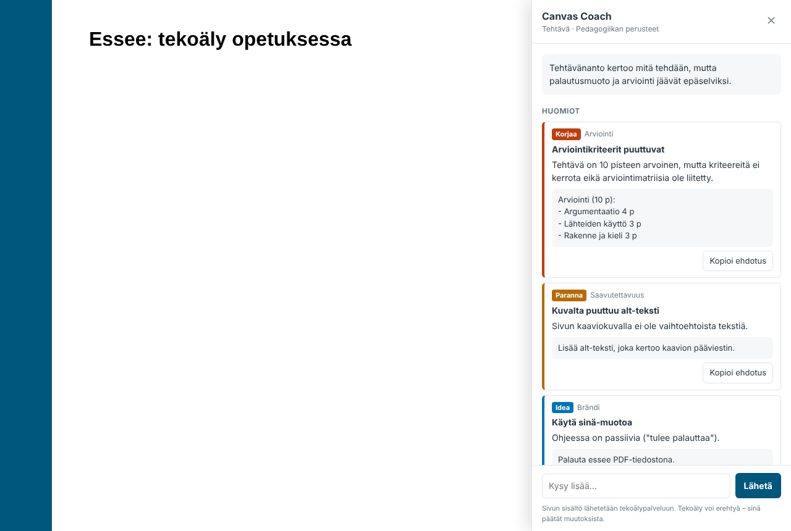

# Canvas Coach

Tekoälysparraaja opettajalle Canvas-oppimisalustaan. Coach näkyy Canvasin sivuilla kelluvana **Coach**-painikkeena. Se lukee sivun, jota opettaja juuri katsoo tai muokkaa, ja antaa palautetta opiskelijan näkökulmasta:

- **Tehtäväsivulla**: puutteet tehtävänannossa (tavoite, palautusmuoto, määräaika, arviointikriteerit, tekoälylinjaus …). Coach vertaa tekstiä myös Canvasin asetuksiin, kuten pisteisiin, palautustapaan ja arviointimatriisiin.
- **Kurssin etusivulla**: mitkä linkit kannattaa nostaa esiin, onko "Aloita tästä" -polkua, ovatko tiedot ajan tasalla.
- **Kaikilla sivuilla**: rakenne, saavutettavuus (otsikot, alt-tekstit, linkkitekstit) ja **brändin mukaisuus** organisaation omaan brandiohjeeseen verrattuna.

Palautteen jälkeen opettaja voi jatkaa keskustelua ("Muotoile minulle arviointikriteerit", "Miten tästä saisi lyhyemmän?").



Tuetut sivut: kurssin etusivu, sisältösivut, tehtävät, keskustelut, tiedotteet, klassiset tentit, syllabus ja moduulit. Muokkaustilassa (`…/edit`) Coach lukee editorissa olevan, vielä tallentamattoman luonnoksen.

## Rakenne

```
Canvas-sivu (selain)                       Canvas Coach -palvelin             Claude API
┌───────────────────────────┐   POST      ┌──────────────────────────┐      ┌──────────┐
│ widget (Shadow DOM)       │ ──────────► │ /api/review  /api/chat   │ ───► │ Claude   │
│ • tunnistaa sivutyypin    │  sivun      │ • tarkistuslista per     │      │ Opus 5.5 │
│ • hakee sisällön Canvas   │  sisältö    │   sivutyyppi + brandiohje│      └──────────┘
│   API:sta opettajan omilla│ ◄────────── │ • API-avain vain täällä  │
│   oikeuksilla             │  palaute    │ • CORS, rate limit, token│
└───────────────────────────┘             └──────────────────────────┘
```

| Kansio | Sisältö |
|---|---|
| `widget/` | Selainosa (TypeScript, ei riippuvuuksia). Paketoituu tiedostoksi `widget/dist/canvas-coach.js`. |
| `server/` | Node.js-palvelin (Hono + Anthropic SDK). Pitää API-avaimen ja kehotteet. |
| `server/config/rubrics/*.md` | Sivutyyppikohtaiset tarkistuslistat. Niitä voi muokata ilman koodausta. |
| `server/config/brand.md` | Organisaation brandiohje. Muutokset tulevat voimaan heti. |
| `extension/` | Chrome/Edge-laajennus kokeiluun ilman Canvas-ylläpitäjän oikeuksia. |
| `theme/` | Latausskripti Canvasin teeman JavaScript-tiedostoksi (tuotantokäyttö). |
| `shared/` | Selaimen ja palvelimen yhteiset tyypit. |

## Pika-aloitus (paikallinen kokeilu)

Tarvitset Node.js 22+:n ja Anthropic API -avaimen.

```bash
npm install
```

```bash
cp server/.env.example server/.env
```

Täydennä tiedostoon `server/.env` vähintään `ANTHROPIC_API_KEY` ja `ALLOWED_ORIGINS` (Canvasin osoite, esim. `https://koulu.instructure.com`). Käynnistä sitten palvelin:

```bash
npm run dev
```

Palvelin käynnistyy osoitteeseen `http://localhost:8787`.

### Kokeilu selainlaajennuksella (ei vaadi ylläpitäjän oikeuksia)

```bash
npm run build:extension
```

1. Avaa Chromessa `chrome://extensions`, laita **Kehittäjätila** päälle ja valitse **Lataa pakkaamaton**. Valitse kansio `extension/build`.
2. Avaa laajennuksen **Asetukset**, kirjoita palvelimen osoitteeksi `http://localhost:8787` ja tallenna.
3. Avaa Canvasissa jonkin kurssin tehtävä- tai etusivu, jolla olet opettajana. Oikeaan alakulmaan ilmestyy **Coach**-painike.

Huomioita:
- Chrome kysyy ensimmäisellä kerralla, saako Canvas-sivu käyttää paikallisen verkon laitteita. Vastaa **Salli**, koska palvelin pyörii omalla koneellasi (`localhost`). Julkisella https-palvelimella kysymystä ei tule.
- Jos Canvasinne osoite ei ole `*.instructure.com`, lisää oma osoite tiedostoon `extension/manifest.json` (molempiin `matches`-kohtiin) ja aja `npm run build:extension` uudelleen.

## Tuotantokäyttö (koko oppilaitokselle)

1. **Julkaise palvelin** https-osoitteeseen (esim. `https://coach.koulu.fi`). Mikä tahansa Node 22 -ympäristö käy:
   ```bash
   npm ci && npm run build && npm start -w server
   ```
   Aseta ympäristömuuttujat: `ANTHROPIC_API_KEY`, `ALLOWED_ORIGINS=https://koulu.instructure.com` ja tarvittaessa `PORT`. Palvelin jakaa itse widgetin osoitteessa `/widget.js`.
2. **Lisää latausskripti Canvasin teemaan**: *Admin → Themes → (teema) → Upload → JavaScript file*. Käytä tiedostoa `theme/canvas-coach-loader.js` ja vaihda siihen palvelimesi osoite. Jos teemassa on jo JavaScriptiä, lisää skripti sen perään.
3. Jos Canvasissa on käytössä **Content Security Policy** (*Admin → Security*), lisää palvelimen osoite sallittuihin domaineihin.

Coach näkyy vain kurssin opettajille, assistenteille (TA), kurssisuunnittelijoille ja ylläpitäjille. Opiskelijat eivät näe sitä.

## Asetukset

| Muuttuja | Oletus | Kuvaus |
|---|---|---|
| `ANTHROPIC_API_KEY` | – | Anthropic API -avain |
| `ALLOWED_ORIGINS` | – | Canvas-osoitteet, joista kutsut sallitaan (pilkuilla erotettuna) |
| `COACH_ACCESS_TOKEN` | – | Valinnainen jaettu tunnus (`X-Coach-Token`) |
| `COACH_MODEL` | `claude-opus-5-5` | Käytettävä Claude-malli |
| `COACH_EFFORT` | `medium` | `low` / `medium` / `high` / `xhigh` / `max`: suurempi on perusteellisempi mutta hitaampi ja kalliimpi |
| `COACH_LANGUAGE` | `suomi` | Palautteen kieli |
| `COACH_RATE_LIMIT` | `20` | Pyyntöjä minuutissa per IP-osoite |
| `COACH_MAX_CONTENT_CHARS` | `150000` | Tätä pidempiä sivuja ei lähetetä. Opettaja saa niistä virheilmoituksen, eikä sisältöä katkaista hiljaa. |

**Tarkistuslistat ja brandiohje** ovat tavallisia Markdown-tiedostoja kansiossa `server/config/`. Pedagoginen tiimi voi muokata niitä suoraan, eikä palvelinta tarvitse käynnistää uudelleen. Jos `brand.md` on tyhjä, brändiä ei arvioida.

## Tietosuoja ja tietoturva

- Coach lähettää tekoälypalveluun vain sen sivun sisällön, jolla opettaja painaa **Tarkista sivu**. Mukana ovat otsikko, teksti, linkit ja asetukset (määräajat, pisteet, arviointimatriisi). Opiskelijoiden palautuksia tai keskusteluvastauksia ei lueta.
- Canvas-tietoihin päästään selaimessa opettajan omalla istunnolla. Coach ei siis näe mitään, mitä opettaja ei itse näe, eikä palvelin saa Canvas-tunnuksia.
- API-avain on vain palvelimella. Palvelin sallii kutsut vain `ALLOWED_ORIGINS`-osoitteista ja rajoittaa kutsumäärää.
- **Rajoitus:** teeman JavaScriptiin kirjoitettu `COACH_ACCESS_TOKEN` näkyy kaikille Canvasin käyttäjille, joten se ei ole salaisuus. Vahvempi tunnistautuminen syntyy, kun Coach paketoidaan LTI 1.3 -työkaluksi tai palvelin sijoitetaan oppilaitoksen kertakirjautumisen taakse (ks. jatkokehitys).
- Tarkista organisaatiosi linjaukset tekoälypalvelujen käytöstä ja Anthropicin sopimusehdot (esim. DPA) ennen laajaa käyttöönottoa.

## Kehitys

```bash
npm test
```

```bash
npm run typecheck
```

```bash
npm run e2e
```

`npm test` ajaa yksikkötestit (widget ja palvelin) ja `npm run typecheck` tyyppitarkistuksen. `npm run e2e` ajaa selaintestin oikealla Chromiumilla vale-Canvasia vasten (vaatii Playwrightin, ks. `e2e/widget.e2e.mjs`).

## Jatkokehitysideoita

- **LTI 1.3 -paketointi**: kunnollinen tunnistautuminen ja käyttöönotto Canvasin Developer Keyn kautta.
- Kurssitason näkymä, joka tarkistaa kaikki moduulit ja sivut kerralla.
- Linkkien toimivuuden tarkistus (rikkinäiset linkit) palvelimella.
- New Quizzes -tuki (toimii LTI-kehyksessä, joten vaatii eri lähestymistavan).
- Ehdotusten vieminen suoraan editoriin yhdellä napilla.
